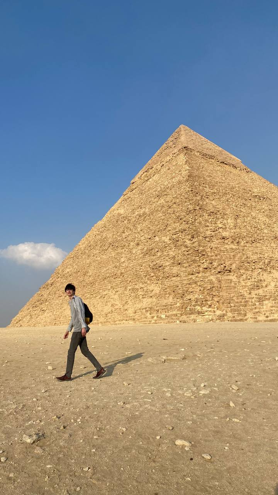

Что хочу сказать - издалека выглядят сильно лучше, чем в близи

Огромные , что писец 

Супер-хаос на входе в комплекс и на территории, просто большой пиздец без организации. 
Внутри самих пирамид скучно, но все-равно - как не зайти? 
 
Из забавного:на входе нас с Рази исподтишка фоткали и на нас показывали пальцем маленькие арабские дети. Должно быть никогда не видели белых людей. Один микрочел попросил селфи
 

И последнее:
С Рождества Иисуса прошло 2024 года

А первая и самая крупная пирамида Хиопса была построена 4500-5000 до рождения Иисуса 
Прикиньте?
